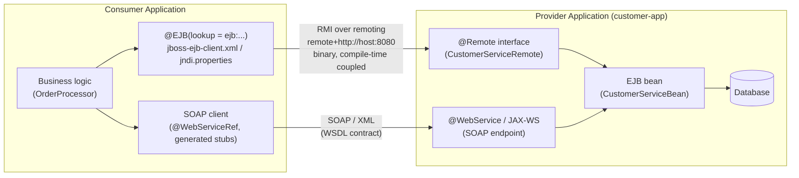
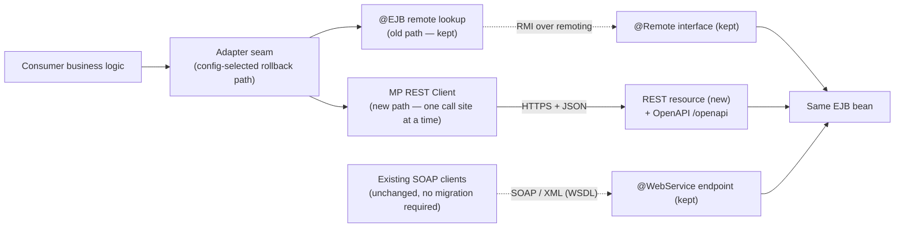
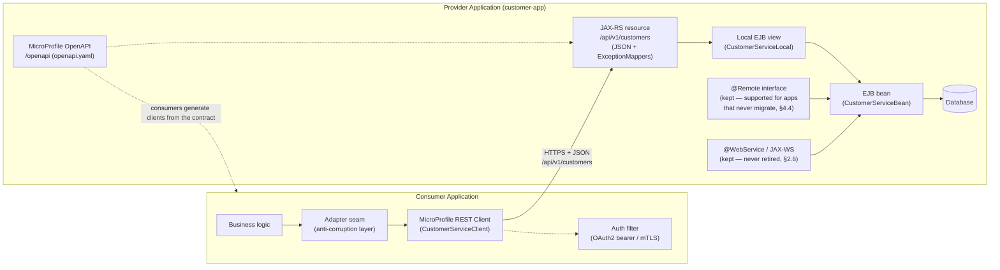

# Refactoring Guide: Inter-Application Calls from EJB to REST

This guide covers migrating **inter-application calls** in a Java Enterprise Application running on **JBoss EAP 8.0+** to **Jakarta REST (JAX-RS) + MicroProfile REST Client**. It handles both directions: this application as a **consumer** of other apps' services, and this application as a **provider** consumed by other apps. Appendix §9 covers what can be automated in this refactoring and what must stay a human decision; appendix §10 documents how the guide and the example were verified (compilation, deployment, runtime testing); a worked before/after example project lives in `example/`.

Two starting points are covered:

- **Remote EJB** (`@Remote` interfaces, JNDI lookups) — the full path in §1–§6.
- **EJBs already exposed as SOAP web services** (`@WebService`, JAX-WS) — **keep the SOAP interface and offer REST in addition**. Existing SOAP clients may not be able to transition to REST easily, so the SOAP endpoint is not retired. Existing source code is changed as little as possible: a new REST facade calls the existing SOAP-exposed EJBs **over the local EJB interface where available** (falling back to the SOAP endpoint otherwise), leaving the EJB code itself untouched.
- **A monolithic JEE application** that uses EJBs (and possibly EJB client artifacts) internally — the refactoring happens in two phases: §1–§6 establish the REST seams, adapters, and security model; §7 then splits the monolith along those seams as the second phase.

> Note: `@WebService` is the **JAX-WS (SOAP)** annotation, not REST. EJBs carrying it are SOAP endpoints. For this variant the migration is **additive**: REST is layered on top of the existing SOAP interface via a facade, and the SOAP interface remains the supported contract for existing clients.

Target stack: Jakarta EE 10 (jakarta.\* namespace) on **JBoss EAP 8.0+**, RESTEasy (classic), MicroProfile REST Client.

> Prerequisite — EAP version and namespace: the `jakarta.*` target requires **JBoss EAP 8.0+**; EAP 7.4 is Jakarta EE 8 (`javax.*`) and has been in Extended Life Support since mid-2025 (maintenance only, no new features). If the codebase is still on `javax.*`, the namespace migration to `jakarta.*` is a separate migration of its own — typically done by upgrading to JBoss EAP 8, or with the Eclipse Transformer tooling. This guide assumes `jakarta.*` on EAP 8.0+ is already in place; run the namespace migration first if it is not.

> Prerequisite — MicroProfile on EAP (EAP XP): base JBoss EAP does **not** include the MicroProfile capabilities this guide relies on — REST Client (§3.2), OpenAPI (§2.7), JWT (§2.4), Fault Tolerance (§5.4), Telemetry (§5.8), and Config. They are delivered by the **EAP Expansion Pack**: JBoss EAP 8.0 + **EAP XP 5.0** provides MicroProfile 6.x; EAP XP 6.0 adds MicroProfile LRA (§5.2). Install it with the `jboss-eap-installation-manager`:

```bash
./bin/jboss-eap-installation-manager.sh install --profile eap-xp-5.0 --dir eap-xp-5.0
# or, on an existing EAP 8.0 installation:
./bin/jboss-eap-installation-manager.sh channel add --channel-name eap-xp-5.0 \
  --repositories=mrrc-ga::https://maven.repository.redhat.com/ga \
  --manifest org.jboss.eap.channels:eap-xp-5.0 --dir <EAP_HOME>
./bin/jboss-eap-installation-manager.sh feature-pack add \
  --fpl org.jboss.eap.xp:wildfly-galleon-pack --dir <EAP_HOME>
```

> `standalone-microprofile.xml` and the `microprofile-*-smallrye` subsystems exist only on an XP installation. If the XP cannot be installed, the guide's fallbacks become the primary paths: plain JAX-RS Client (§3.4), the manual OpenAPI endpoint (§2.7), and Elytron token validation (§2.4, which needs no XP).

> Transport security: the `http://` URLs in the examples are placeholders. In production, every inter-application call must run over TLS (`https://`), terminated by the load balancer or JBoss EAP itself — the §3.5 auth options (bearer tokens, basic auth) are only safe over TLS.

---

## When Not to Use This Guide

This guide is for migrating **existing inter-application EJB calls (or SOAP-exposed EJB calls) between JBoss EAP 8.0+ applications to REST**. It does not apply — or adds no value — in the following situations:

| Situation | Why the guide does not apply | What to do instead |
|---|---|---|
| **Local EJB/CDI calls inside one deployment** | These calls never cross an application boundary; there is nothing to expose over REST, and wrapping them in REST adds latency and serialization for no gain. | Keep the local interfaces. Only §7 (splitting a monolith) applies — and only if a clear functional or business domain crossing exists (§7 rule). |
| **You are not on JBoss EAP 8.0+** | The `jakarta.*` examples and the EAP XP prerequisites assume EAP 8.0+; EAP 7.4 is `javax.*` and in Extended Life Support. | Upgrade to EAP 8 first, or write a `javax`-namespace variant of this approach (the patterns are the same; the imports and subsystem steps differ). |
| **The integration is asynchronous messaging (JMS)** | Fire-and-forget and event-driven integration is a different pattern; synchronous REST is the wrong tool for it. | Keep or introduce JMS. REST applies only where a synchronous request/response is genuinely needed. |
| **Atomic transactions must span the two applications** | REST cannot propagate transactions (§5.2, §5.6). If a flow only works atomically and cannot be redesigned, migrating it breaks correctness. | Keep the coupled path (IIOP/XTS) until the flow is redesigned — saga, compensation, or EAP XP 6.0+ LRA (§5.2). Do not migrate "as is". |
| **Working SOAP integration with WS-Security, no REST requirement** | The guide's SOAP variant keeps SOAP as the supported contract anyway (§2.6) — if the integration works and no new consumers need REST, migrating is effort without benefit. | Leave it on SOAP. Use this guide only if a REST contract is actually needed (new consumers, API consolidation, EJB retirement plans). |
| **Consumers you cannot coordinate with** | The migration requires consumer teams to change call sites on a schedule (§4). Third-party-owned consumers cannot be driven to cut over. | Keep the existing contract (`@Remote` stays supported, §4.4; SOAP stays, §2.6) and add REST in addition only if you own the consumers for the REST path. |
| **Latency-critical, very high-frequency calls** | REST + JSON adds per-call overhead versus binary remoting (§5.5). For chatty same-datacenter calls without a modularization goal, the cost may outweigh the benefit. | Batch endpoints first (§5.5); or reconsider whether the call should cross an app boundary at all — moving the logic or keeping the modules in one deployment (§7) may be cheaper. |
| **Public/external APIs** | This guide targets internal inter-application integration. Public contracts need more: CORS, rate limiting, developer portal, stricter versioning and deprecation policy. | Use an API-design practice for external contracts; §2.3's endpoint rules are a starting point, not sufficient. |
| **New (greenfield) services** | New services should not start from EJB remoting patterns at all — the migration would be a detour. | Design JAX-RS/messaging directly from the start; this guide only migrates existing EJB couplings. |

In short: use this guide when **existing EJB couplings between applications must move to REST**, with a clear functional or business domain boundary, consumers you can coordinate with, and no hard dependency on cross-application atomicity. When in doubt about a single call, the §1.2 inventory items (transactions, security, data, consumers) double as a per-call-site go/no-go check.

---

## Why Do This? Benefits and Trade-offs

The migration trades a proprietary, version-coupled, tool-opaque integration style for an open, observable, independently evolvable one — at the cost of explicit per-call overhead and redesigned cross-app transaction assumptions.

**Benefits:**

- **Decoupling** — consumers no longer compile against the shared `@Remote` interface jar; the contract is the published OpenAPI document, so the provider can evolve its implementation and DTOs behind a stable API (§3.7 DTO provenance).
- **Independent release cycles** — provider and consumer teams deploy, version, and release on their own schedules instead of coordinating shared-jar versions.
- **Seam for splitting (§7)** — the REST/adapter seams are exactly where the deployment boundaries go if the monolith is split later; a remote-EJB interim hides that seam, REST makes it explicit and tool-inspectable.
- **Vendor- and language-neutral consumers** — any stack can call the service; EJB remoting locks consumers to Java with matching JBoss EJB client library versions.
- **Network-friendly** — HTTP/HTTPS works over standard ports with load balancers, proxies, API gateways, and firewalls; EJB remoting uses custom protocols/ports that operations teams struggle to support.
- **Standard observability** — access logs, correlation IDs, OpenTelemetry tracing, metrics, and gateway monitoring work out of the box on HTTP (§5.8); EJB remoting is opaque to standard tooling.
- **Cloud/OpenShift readiness** — HTTP services fit health probes, service discovery, ingress, and service meshes; a natural entry point to the EAP XP OpenShift image or bootable JAR.
- **Standard security** — OAuth2/OIDC bearer tokens and mTLS integrate with the enterprise identity provider; EJB remoting identity propagation is proprietary (§3.5).
- **Explicit resilience** — timeouts, retries, circuit breakers, and bulkheads (§5.4) replace EJB's implicit, server-configured timeouts; failures become visible and controllable instead of mysterious (`NoSuchEJBException`).
- **Standardized error contract** — HTTP status codes plus a consistent JSON error body (§5.3) replace opaque EJB exception propagation.
- **Testability** — endpoints are testable with curl/Postman; consumer tests mock HTTP trivially (WireMock); contract tests compare old and new paths automatically (§4.5).
- **Human-readable debugging** — JSON payloads can be inspected in flight; the live OpenAPI document is executable documentation.

**Trade-offs (honest, already handled in this guide):**

- **Not free performance-wise** — REST + JSON adds per-call latency and serialization overhead vs. binary remoting; batch endpoints mitigate it (§5.5).
- **Not simpler semantics** — transactions no longer span applications (§5.2) and JSON is less strict than Java serialization (§5.1); idempotency and compensation work becomes explicit.
- **Not a big-bang** — the benefit accrues per migrated seam, which is why the guide is built around strangler-fig coexistence (§4) rather than a rewrite.

---

## Architecture Before and After

The diagrams below show the high-level architecture before the migration, during the parallel-run phase (§4), and in the target state. Phase 2 (§7, splitting a monolith) reuses the same target-state pattern for every seam created by the split.

### Before: EJB remoting / SOAP between applications



### During migration: both paths in parallel (§4, strangler fig)



### After (target state): REST added — old paths kept



What changed:

- **Protocol**: binary RMI/remoting (`ejb:` lookups, `remote+http://`) → HTTPS + JSON via REST for the call sites you migrate; the WSDL contract is complemented (not replaced) by the OpenAPI document.
- **Coupling**: migrated consumers depend on the published API contract (generated client interfaces + DTOs) instead of the shared `@Remote` interface jar; consumers that never migrate keep using the `@Remote` interface or SOAP.
- **Security**: identity propagated by the remoting layer → per-request OAuth2 bearer token / mTLS (§3.5).
- **Resilience**: implicit server-configured timeouts → explicit timeouts, retries, `@CircuitBreaker`/`@Bulkhead` on the adapter (§5.4).
- **Unchanged**: the EJB bean and its business logic stay; the REST resource calls it over the **local view** (pass-by-reference, shared transaction — §2.5). The **SOAP endpoint, its WSDL, and all existing SOAP clients are never retired** as part of this migration (§2.6, §4.4), and the `@Remote` interface likewise stays supported — retiring either is only a possible separate future decision after the §4.4 audit shows every consumer has demonstrably moved.

---

## 1. Discovery / Audit

Before changing any code, inventory every inter-application EJB call site.

### 1.1 What to search for

| Pattern | Where | Indicates |
|---|---|---|
| `@EJB(lookup = "...")` / `@EJB` with `beanName`/`mappedName` | Consumer code | Remote bean injection, note the JNDI name and target app |
| `InitialContext.lookup("ejb:...")` | Consumer code | Programmatic remote EJB lookup |
| `jboss-ejb-client.xml` | Consumer `META-INF/` | JBoss EAP outbound EJB client connection definitions |
| `jndi.properties` | Consumer classpath | Legacy `java.naming.provider.url=remote+http://host:8080` |
| `@Remote` interfaces | Provider code | Business interfaces exposed to other apps |
| `@WebService`, `@WebMethod`, `@WebParam`, `@WebResult`, `@SOAPBinding` | Provider code | EJBs already exposed as SOAP endpoints (JAX-WS variant — see note in the introduction) |
| `jakarta.xml.ws` / `javax.xml.ws` imports | Both sides | JAX-WS client or endpoint code |
| `@WebServiceRef` / generated `Service` classes | Consumer code | SOAP client usage against another app |
| WSDL files, `wsimport`/`wsconsume` generated stubs | Consumer code | Generated SOAP client artifacts to replace |
| `org.jboss.ejb.client.*` imports | Consumer code | Direct remoting API usage |
| `ejb:` URL strings | Consumer code | Inline JNDI lookups across deployments |
| `corbaloc:` URLs, `javax.rmi.*` / `org.omg.CORBA` imports | Consumer code | RMI-IIOP clients — transactions and security propagate (§5.6) |
| Standalone-xml `remote-outbound-connections`, `iiop-configuration` | Server config | Server-level remoting wiring |

Example commands:

```bash
grep -rn "@Remote" --include="*.java" src/
grep -rn "InitialContext" --include="*.java" src/
grep -rln "jboss-ejb-client.xml" --include="*.xml" .
grep -rn "ejb:" --include="*.java" src/
# SOAP (JAX-WS) variant
grep -rn "@WebService\|@WebMethod" --include="*.java" src/
grep -rn "@WebServiceRef" --include="*.java" src/
find . -name "*.wsdl" -o -name "*_PortType.java" | head
```

### 1.2 Build an inventory

For each call site, record:

- **Provider bean**: target app name, bean class, remote interface
- **Consumer call sites**: class, method, call frequency (if known)
- **Data exchanged**: parameter types, return types — flag types that will need DTO/JSON mapping (heavy entities, custom types, collections)
- **Error contract**: checked exceptions declared on the interface, unchecked exceptions thrown
- **Transactionality**: does the call participate in the caller's transaction (`@TransactionAttribute(MANDATORY)` or `REQUIRED` spanning both apps)?
- **Security**: role checks (`@RolesAllowed`) on the remote interface, the caller's identity propagation mechanism. For SOAP endpoints (JAX-WS variant): whether WS-Security headers are used — the most common hidden cost of the migration, as they are replaced by the §3.5 auth options
- **Consumers outside your control**: for SOAP/WSDL endpoints, whether third-party apps consume the WSDL — another reason to keep the SOAP interface and add REST in addition (§2.6), since these clients transition at their own pace
- **Network path**: firewall rules, load balancers, and DNS entries that point at the remoting port (or the SOAP port, for the §2.6 variant) and must be re-pointed at REST or retired with the old path

### 1.3 Decide the migration order

Favor: simple read-only calls first → complex write calls → calls that participate in transactions last. Migrate **one provider interface at a time**, keeping the old EJB endpoint and the new REST endpoint live in parallel (see §4).

---

## 2. Provider-Side Transformation (Exposing EJB functionality as REST)

The provider application owns an EJB that other apps call via its `@Remote` interface. You add a REST resource that wraps the bean and offer REST **in addition** — the remote interface is **not removed**, because applications may still be using it that have migrated to neither SOAP nor REST. It stays supported alongside REST (see §4.4).

If the EJB already carries `@WebService` (SOAP), **do not replace it — keep it and offer REST in addition**. Existing clients may not be able to transition to REST easily, so the SOAP endpoint stays the supported contract. Change existing source code as little as possible: add a new REST facade class that calls the existing SOAP-exposed EJB **over its local EJB interface where available** (falling back to the SOAP endpoint otherwise) — the EJB itself is not modified (see §2.6). The existing `@WebMethod` signatures serve as the endpoint design blueprint: each `@WebMethod` maps to one REST operation using the table in §2.3.

### 2.1 Before: EJB remote interface

```java
// javax / Java EE 8 era, JBoss EAP EJB remoting
@Remote
public interface CustomerServiceRemote {
    CustomerDTO findCustomer(long id) throws CustomerNotFoundException;
    List<CustomerDTO> searchCustomers(String nameFilter);
    CustomerDTO updateAddress(long id, AddressDTO address)
            throws CustomerNotFoundException, ValidationException;
}
```

JAX-WS variant — the same functionality already exposed as SOAP:

```java
@WebService(name = "CustomerService", serviceName = "CustomerServiceService")
@SOAPBinding(style = SOAPBinding.Style.DOCUMENT)
@Stateless
public class CustomerServiceBean {

    @WebMethod(operationName = "findCustomer")
    @WebResult(name = "customer")
    public CustomerDTO findCustomer(@WebParam(name = "id") long id)
            throws CustomerNotFoundException { ... }

    @WebMethod(operationName = "updateAddress")
    public CustomerDTO updateAddress(@WebParam(name = "id") long id,
            @WebParam(name = "address") AddressDTO address)
            throws CustomerNotFoundException, ValidationException { ... }
}
```

### 2.2 After: REST resource wrapping the EJB

```java
// jakarta / Jakarta EE 10
@Path("/api/v1/customers")
@Produces(MediaType.APPLICATION_JSON)
@Consumes(MediaType.APPLICATION_JSON)
@RequestScoped
public class CustomerResource {

    @Inject
    private CustomerServiceLocal customerService; // same bean, local view or no-interface view

    @GET
    @Path("/{id}")
    public CustomerDTO getCustomer(@PathParam("id") long id) throws CustomerNotFoundException {
        return customerService.findCustomer(id);
    }

    @GET
    public List<CustomerDTO> search(@QueryParam("nameFilter") String nameFilter) {
        return customerService.searchCustomers(nameFilter);
    }

    @PUT
    @Path("/{id}/address")
    public CustomerDTO updateAddress(@PathParam("id") long id, AddressDTO address)
            throws CustomerNotFoundException, ValidationException {
        return customerService.updateAddress(id, address);
    }
}
```

> **URLs and `@ApplicationPath`:** if the deployment's JAX-RS `Application` carries `@ApplicationPath("/api")`, paths on resource classes are relative to it — the class above would need `@Path("/v1/customers")` to serve `/api/v1/customers`. Make sure the effective URLs match the published OpenAPI document (§2.7) exactly.

> **No local view?** The examples inject a local interface (`CustomerServiceLocal`). A bean that historically only had a `@Remote` interface may not have one — add a local interface. The no-interface view is another option, but note: a `@Stateless` bean that implements an interface (e.g. the `@Remote` one) does **not** expose the no-interface view unless you also annotate it with `@LocalBean` — without it, injecting or looking up the bean's concrete class fails at runtime (`WFLYEJB0406: No Jakarta Enterprise Beans found with interface of type ...`, verified against EAP 8). The view changes semantics: a **local** call is pass-by-reference and joins the caller's transaction; the **remote** view is pass-by-value and starts its own transaction (§2.5). Injecting the local view from the REST resource is what keeps the REST request behaving like the old local call chain inside the provider.

Map exceptions to HTTP status codes with an `ExceptionMapper`:

```java
@Provider
public class CustomerNotFoundExceptionMapper implements ExceptionMapper<CustomerNotFoundException> {
    @Override
    public Response toResponse(CustomerNotFoundException e) {
        return Response.status(Response.Status.NOT_FOUND)
                .entity(new ErrorBody("CUSTOMER_NOT_FOUND", e.getMessage()))
                .build();
    }
}
```

> **Registration:** `@Provider` classes (mappers, filters) are only discovered automatically inside a CDI bean archive (the default for Jakarta EE 10 WARs with a `beans.xml`). If a mapper doesn't fire, register it explicitly on the JAX-RS `Application` subclass before debugging anything else.

### 2.3 Endpoint design rules

| EJB method shape | REST mapping |
|---|---|
| `findX(id)` | `GET /xs/{id}` |
| `searchX(filter)` | `GET /xs?filter=...` |
| `createX(dto)` | `POST /xs` → `201 Created` + `Location` header |
| `updateX(id, dto)` | `PUT /xs/{id}` (full) or `PATCH` (partial) |
| `deleteX(id)` | `DELETE /xs/{id}` → `204 No Content` |
| Command-style operation (`activateX(id)`) | `POST /xs/{id}/activation` (model as sub-resource of a noun) |
| `@Asynchronous` method (`Future<T> startX(id)`) | `POST /xs/{id}/jobs` → `202 Accepted` + status URL; consumer polls `GET /xs/{id}/jobs/{jobId}` or receives a callback (§5.7) |

Rules:

- **Nouns, not verbs** in paths; only `GET`/`POST`/`PUT`/`PATCH`/`DELETE` as verbs.
- **Idempotency**: `GET`, `PUT`, `DELETE` must be idempotent. If the EJB method is not idempotent (e.g., retry may double-charge), map it to `POST` and consider an `Idempotency-Key` header.
- **Optimistic locking**: if the EJB used version checks (e.g. `@Version` on entities), expose them as an `ETag` on `GET` responses and require `If-Match` on `PUT`/`PATCH`/`DELETE`; a failed version check becomes `412 Precondition Failed` (or `409` — pick one and document it, §5.3).
- **Version the API** from day one: `/api/v1/...`. Plan for v2 now: introduce it as a new path (or parallel deployment) next to v1, mark retiring v1 operations with `Deprecation`/`Sunset` headers, and notify consumer teams in advance — never change a published operation in place.
- **Paginate** list endpoints that can return large result sets (`GET /xs?filter=...&page=0&size=50`) — a remote EJB call returning everything was already questionable; over REST it becomes a payload-size problem (§5.5).
- Keep the remote DTO classes, but make them JSON-friendly: default constructor, public getters/setters, no `javax.persistence.*` lazy fields leaking into serialization. If the DTOs are shared types inside entity classes, introduce dedicated REST DTOs.
- **Bean Validation**: annotate resource method parameters with `@Valid` (and the DTOs with constraint annotations) so argument checks fail fast with an automatic `400` — the cheap replacement for the boundary checks the remote EJB enforced.
- **Binary and large payloads**: for files and large blobs, decide per endpoint between Base64-in-JSON (simple, ~33% size overhead) and `multipart/form-data` or a `StreamingOutput` download (efficient, more client work). Don't ship blobs through JSON DTOs by default.

### 2.4 Security mapping

Replace EJB method security with REST security:

- `@RolesAllowed` still works on JAX-RS resources in Jakarta EE — keep the same role names when possible.
- **Configure the provider to validate the bearer tokens** the consumers send (§3.5). On JBoss EAP with the EAP XP installed (see the prerequisite note), the simplest standard path is the MicroProfile JWT subsystem: enable `microprofile-jwt-smallrye` (present in `standalone-microprofile.xml`), declare the auth method in the deployment, and point the deployment at the identity provider. NOTE: `@LoginConfig` does **not** exist in Jakarta EE 10 (it arrived in EE 11) — on EAP 8.0/8.1, declare the auth method in `web.xml` (`<login-config><auth-method>MP-JWT</auth-method></login-config>`, plus the `microprofile-jwt-smallrye` subsystem). Verified at runtime: on base EAP 8 GA/8.1 (no XP) the `MP-JWT` auth method fails the deployment with `The required mechanism 'MP-JWT' is not available` — the subsystem is XP-only:

```properties
# microprofile-config.properties
mp.jwt.verify.publickey.location=https://idp.example.com/realms/acme/protocol/openid-connect/certs
mp.jwt.verify.issuer=https://idp.example.com/realms/acme
```

The token's `groups` claim maps directly to the roles checked by `@RolesAllowed`. For more control (other claims, custom role mapping), use an Elytron `token-realm` (JWT) instead — Elytron is part of base EAP and needs no EAP XP, so it is also the route to use when the XP cannot be installed.
- If the EJB relied on caller propagation over remoting, the REST consumer must now send credentials/identity per request (see §3.5).
- Remove `ejb:` remoting permissions from the server config (`remote-outbound-connection`, security realms used only for remoting) only once **all** consumers — including remote-EJB consumers that never migrated — have cut over. Audit remaining users first; removal is a separate decision (see §4.4).

### 2.5 Transaction boundary change (important)

A remote EJB call starts its **own** transaction on the provider side — client-initiated transactions never spanned remote EJB calls unless using IIOP/XTS. But a **local** call chain inside the provider did share a transaction. After adding the REST layer:

- Each REST request is one transaction boundary. All EJB work within a single REST request runs in one transaction (default `REQUIRED`) — usually equivalent to before.
- Anything the *consumer* did after the EJB call returned, in the same "logical operation", is now **not** atomic with the provider's work. Handle with idempotency + compensating actions (see §5.2).

### 2.6 SOAP variant: REST facade over the local EJB interface (fallback: SOAP)

For EJBs already exposed as SOAP (`@WebService`), add only new classes; do not touch the EJB. The facade calls the bean over its **local EJB interface when available** (same application/server); only if no local view exists — e.g. the bean lives in another deployment/EAR or exposes only the SOAP port — does it fall back to calling the SOAP endpoint over HTTP:

> Namespace note: on the target stack (Jakarta EE 10) the SOAP endpoint and any generated stubs must also use `jakarta.xml.ws.*` — JBoss EAP 8 `wsconsume` generates jakarta-namespace stubs. `javax.xml.ws` clients only work against a server that still runs the `javax` namespace.

```java
// NEW REST facade — no changes to the existing @WebService EJB
@Path("/api/v1/customers")
@Produces(MediaType.APPLICATION_JSON)
@Consumes(MediaType.APPLICATION_JSON)
@ApplicationScoped
public class CustomerRestFacade {

    // Preferred: call the bean directly via its local view (same application/server)
    @EJB
    private CustomerServiceLocal customerService;

    @GET
    @Path("/{id}")
    public CustomerDTO getCustomer(@PathParam("id") long id) throws CustomerNotFoundException {
        return customerService.findCustomer(id);
    }

    @PUT
    @Path("/{id}/address")
    public CustomerDTO updateAddress(@PathParam("id") long id, AddressDTO address)
            throws CustomerNotFoundException, ValidationException {
        return customerService.updateAddress(id, address);
    }
}
```

Fallback — only when no local view is reachable, delegate to the existing SOAP endpoint instead (same facade body, different injected dependency):

```java
// Fallback: bean not reachable locally → call the existing SOAP endpoint
@WebServiceRef(wsdlLocation = "http://localhost:8080/CustomerServiceService?wsdl")
private CustomerServiceService soapService;

// in each method: soapService.getCustomerServicePort().findCustomer(id)
```

Keep the choice in one place — a single injected field per facade. If the bean moves between deployments later, switching forms is a one-line change thanks to the delegation-only rule.

Map exceptions to HTTP status codes with the same `ExceptionMapper` pattern shown above (§2.2). With the local view the bean throws its business exceptions directly — the same classes the SOAP `@WebFault` types wrap — so translation stays in one place either way.

Design rules for the facade:

- **New code only** — the facade is additive; the SOAP EJB, its WSDL, and all existing clients keep working unchanged.
- **Delegate, don't duplicate** — all business logic stays in the EJB; the facade only translates HTTP/JSON ↔ EJB/SOAP calls. No business rules leak into the facade.
- **Local first** — call the bean via its local view when available: no serialization overhead, the call joins the REST request's transaction (§2.5), and `@RolesAllowed` on the bean still applies. Existing source code is changed minimally — one injected field, no modifications to the EJB itself.
- **SOAP as fallback** — if no local view exists (bean in another deployment/EAR, only the SOAP port exposed), delegate to the SOAP endpoint via `@WebServiceRef`. Trade-offs: HTTP + XML serialization overhead per call, and any WS-Security or port-level checks of the SOAP layer are bypassed on the local path — the facade's own REST security (§2.4) replaces them.

**JAX-WS capabilities without a JAX-RS equivalent** — several SOAP/WS-* capabilities have no 1:1 translation. If existing consumers depend on one of these, those consumers stay on the SOAP endpoint (§4.4); REST is added only for consumers that do not need them:

| Capability | Why it does not translate | REST substitute |
|---|---|---|
| **WS-Security message-level signing/encryption** | XML signature/encryption of the message itself (WSS4J, WS-SecurityPolicy) has no REST standard equivalent; TLS protects the *connection*, not the *message* — no end-to-end integrity through intermediaries, no built-in non-repudiation. | TLS + mTLS + OAuth2/OIDC bearer tokens (§3.5); JOSE/JWS payload signing is possible but ad hoc, not part of the JAX-RS stack |
| **WS-ReliableMessaging** | Guaranteed, ordered, exactly-once delivery has no REST standard. | Retries + idempotency keys (§5.4), or JMS/events where delivery guarantees are genuinely needed |
| **WS-AtomicTransaction / WS-Coordination (XTS)** | ACID transactions across the wire do not exist in REST. | LRA (EAP XP 6.0, §5.2) — but compensation-based, not ACID: a strict downgrade in semantics |
| **WS-Addressing** | Message IDs, endpoint references, `ReplyTo`/`FaultTo`, asynchronous callbacks — no REST standard. | Correlation IDs (§5.8), `202 Accepted` + polling or webhooks — ad hoc, not standardized |
| **Strict XSD schema validation** | SOAP endpoints validate every payload against the XSD before processing; JSON has no namespaces, element ordering, `nillable`, or attributes, and type mapping (e.g. `xsd:duration`, date precision) is lossy. | Opt-in Bean Validation on DTOs or JSON Schema — contract-soft by default (§5.1) |
| **Handler chains / `mustUnderstand` headers** | SOAP handler chains process message-level headers with mandatory-understood semantics. | JAX-RS filters/interceptors — HTTP-header level, different semantics |

**Translatable capabilities — the design work they need.** The rest of the SOAP surface translates, but not 1:1; each capability needs explicit design work at the new REST seam:

- **MTOM/XOP binary attachments → streaming bodies.** Model the attachment as its own resource (`PUT /customers/{id}/avatar`), use `application/octet-stream` for a single binary or `multipart/form-data` for several parts; stream instead of buffering (`InputStream`, enforce a size limit *before* reading fully); set explicit content types and reject unknown ones with 415; decide where the binary lands (object store, DB BLOB) — the EJB's original in-memory attachment handling usually must be reworked, since payloads no longer ride inside the SOAP envelope.
- **`@Oneway` fire-and-forget → `202 Accepted` + async processing.** Return `202 Accepted` immediately with a `Location` header pointing at a status resource (`GET .../status`); run the work via an `@Asynchronous` EJB method (§5.7) or a JMS message. Decisions: how the consumer learns of completion (polling vs callback), idempotency on retries of the POST (§5.4), and whether "one-way" should now carry an acknowledgment at all — it is visible on the wire.
- **RPC/encoded or document/literal wrapping → resource modeling.** Re-express each WSDL operation as a resource + HTTP method + status code (§2.3): operations returning different result types become distinct resources, wrapped responses become sub-resources or embedded DTOs, and per-operation semantics (query vs command) map to GET vs POST/PUT. This is judgment work the WSDL does not do for you; the OpenAPI document then becomes the contract (§2.7).
- **SOAP handler chains → JAX-RS filters/interceptors.** Each handler that processed SOAP headers becomes a `ContainerRequestFilter`/`ContainerResponseFilter` (or a REST Client filter on the consumer side) working with HTTP headers — correlation IDs, audit logging, tenant routing. Header semantics differ: there is no `mustUnderstand` equivalent, so a filter that must reject unknown mandatory headers has to enforce that itself (417 or 400).
- **WSDL-first tooling → OpenAPI-first.** Publish the OpenAPI document (§2.7), keep it in CI, and generate client interfaces/DTOs from it (§3.7) instead of `wsconsume`; version the document like the WSDL was versioned (§2.3 URL versioning).
- **XSD enforcement → Bean Validation.** Annotate the DTOs with constraints (`@NotNull`, `@Size`, `@Pattern`), validate with `@Valid` on resource methods, and map `ConstraintViolationException` to a 400 with the same JSON error body shape as §5.3. Unlike XSD (reject-before-processing), Bean Validation runs in-application — decide per endpoint whether invalid input fails fast or is coerced.

The worked example (`example/after/`) shows the translatable design work in code: avatar streaming (MTOM → `octet-stream`), the 202-async one-way pattern, a Bean Validation mapper, and a correlation-ID filter.

### 2.7 Expose the OpenAPI document via the REST endpoints

The shared contract must be reachable by consumers over HTTP. On JBoss EAP with the EAP XP installed, the **MicroProfile OpenAPI** subsystem (`microprofile-openapi-smallrye`) serves the document from the same deployment as the REST facade at the deployment root — `http://<host>:8080/openapi` (JSON by default; `Accept: application/yaml` returns YAML). No separate endpoint or application is needed. There is no example document at the repository root — the worked example ships one with the provider (`example/after/customer-provider/src/main/resources/META-INF/openapi.yaml`); for your own endpoints, derive the document from your actual API.

**Minimal-change option (no code touched):** ship the document as a static file — place your derived document in `src/main/resources/META-INF/openapi.yaml` (the worked example does exactly this: `example/after/customer-provider/src/main/resources/META-INF/openapi.yaml`). Static documents are merged with generated metadata (static entries take precedence), so the shared spec is exactly what consumers see.

Enable the subsystem — present by default in `standalone-microprofile.xml`, which exists only on an EAP XP installation (see the prerequisite note); adding it via CLI requires the EAP XP feature pack:

```bash
/extension=org.wildfly.extension.microprofile.openapi-smallrye:add()
/subsystem=microprofile-openapi-smallrye:add()
```

or in `standalone.xml`:

```xml
<extension module="org.wildfly.extension.microprofile.openapi-smallrye"/>
<!-- ... -->
<subsystem xmlns="urn:wildfly:microprofile-openapi-smallrye:2.0"/>
```

Verify:

```bash
curl -H "Accept: application/yaml" http://customer-app:8080/openapi | head -20
```

**Keep doc and code in sync (optional):** annotate the facade so the deployment also contributes operation metadata; annotations and the static document are merged. Minimal useful annotations on the new facade only:

```java
@GET
@Path("/{id}")
@Operation(summary = "Find a customer by id", operationId = "getCustomer")
@APIResponse(responseCode = "200", description = "The customer")
@APIResponse(responseCode = "404", description = "No customer with the given id exists")
public CustomerDTO getCustomer(@PathParam("id") long id) throws CustomerNotFoundException { ... }
```

plus `@SecurityRequirement(name = "bearerAuth")` at class level (annotations from `org.eclipse.microprofile.openapi.annotations.*`). `@Schema` on the DTOs can document types from code instead of the static file.

**Manual fallback:** if the subsystem cannot be used, or the document must live under the facade path, serve it from a tiny new resource:

```java
@Path("/api/v1/openapi")
@Produces("application/yaml")
@ApplicationScoped
public class OpenApiDocumentResource {

    @GET
    public String openapi() throws IOException {
        try (InputStream in = getClass().getResourceAsStream("/META-INF/openapi.yaml")) {
            return new String(in.readAllBytes(), StandardCharsets.UTF_8);
        }
    }
}
```

Prefer the standard `/openapi` URL — tooling such as Swagger UI and `openapi-generator-cli` expects it; the manual endpoint is only for special cases. Consumers generate their client interfaces from the live document (see the tip in §3.2).

The `operationId` values are load-bearing: code generators (§3.2 tip) turn them into method names, so renaming one silently breaks every generated client. Treat an `operationId` change as a breaking API change.

---

## 3. Consumer-Side Transformation (Calling REST instead of EJB)

The consumer application currently injects a `@Remote` interface, does JNDI lookups, or uses a SOAP client against another app.

### 3.1 Before: @EJB injection of remote interface

```java
// before
@Stateless
public class OrderProcessor {

    @EJB(lookup = "ejb:customer-app/customer-ejb/CustomerServiceBean!com.acme.customer.CustomerServiceRemote")
    private CustomerServiceRemote customerService;

    public Order placeOrder(Order order) throws CustomerNotFoundException {
        CustomerDTO customer = customerService.findCustomer(order.getCustomerId());
        // ...
    }
}
```

> **Runtime-verified gotcha — the `ejb:` URL is coupled to deployment names and to the
> client's process.** The `ejb:<app>/<module>/<bean>!<view>` form only resolves if
> those names match the *deployed* artifacts (an EAR's `app`/`module`, or for a
> standalone WAR the runtime-name base). If the deployments are renamed during the
> migration, the lookup resolves to nothing at invocation time — EAP accepts the
> injection but the call fails with `EJBCLIENT000409: No more destinations are
> available` (verified against EAP 8.0.11 and 8.1). Also verified: *inside the same server*,
> `ejb:` URLs are treated as remote destinations and do not route in-VM even when the
> names match — for a consumer deployed to the same server, look up the provider's
> `java:global/<deployment-name>/<bean>!<view>` binding instead (the server prints
> these exact bindings at deploy time). The `ejb:` form is for consumers in a
> separate process, where it needs a configured `remote-outbound-connection`
> (see "Deployment Descriptors to Check"). During the migration, check every
> `ejb:` lookup against the *actual* deployment names.

### 3.2 After: MicroProfile REST Client

Define a client interface mirroring the provider's REST API:

```java
@Path("/api/v1/customers")
@RegisterRestClient(baseUri = "http://customer-app:8080")
@RegisterProvider(CustomerNotFoundResponseExceptionMapper.class)
public interface CustomerServiceClient {

    @GET
    @Path("/{id}")
    CustomerDTO getCustomer(@PathParam("id") long id);
}
```

The client needs its own error translation. This implements the **MicroProfile** interface — the server-side `jakarta.ws.rs.ext.ExceptionMapper` from §2.2 has **no effect** on a REST client:

```java
@Provider
public class CustomerNotFoundResponseExceptionMapper
        implements ResponseExceptionMapper<CustomerNotFoundException> {

    @Override
    public boolean handles(int status, MultivaluedMap<String, Object> headers) {
        return status == 404;
    }

    @Override
    public CustomerNotFoundException toThrowable(Response response) {
        return new CustomerNotFoundException("Customer not found (HTTP 404)");
    }
}
```

Inject and use it:

```java
@ApplicationScoped
public class OrderProcessor {

    @Inject
    @RestClient
    private CustomerServiceClient customerService;

    public Order placeOrder(Order order) throws CustomerNotFoundException {
        CustomerDTO customer = customerService.getCustomer(order.getCustomerId());
        // ...
    }
}
```

> **Runtime-verified: the CDI injection above requires the EAP XP.** On base EAP 8 GA
> (no XP) the deployment fails with `WELD-001408: Unsatisfied dependencies for type
> CustomerServiceClient with qualifiers @Default` — the MicroProfile REST Client CDI
> extension is part of the XP, not base EAP (verified on EAP 8.0.11 and 8.1). On base EAP,
> build the client programmatically instead (`RestClientBuilder` is
> `org.eclipse.microprofile.rest.client.RestClientBuilder`; the API jar alone still
> compiles on base EAP — only the CDI wiring and the runtime implementation are XP
> features):

```java
CustomerServiceClient client = RestClientBuilder.newBuilder()
        .baseUri(URI.create("http://customer-app:8080"))
        .register(CustomerNotFoundResponseExceptionMapper.class)
        .build(CustomerServiceClient.class);
```

Configure per-environment (MicroProfile Config — requires EAP XP; on base EAP use system properties or environment variables instead):

```properties
com.acme.customer.CustomerServiceClient/mp-rest/url=http://customer-app:8080
com.acme.customer.CustomerServiceClient/mp-rest/connectTimeout=2000
com.acme.customer.CustomerServiceClient/mp-rest/readTimeout=5000
```

> Tip: instead of writing the client interface by hand, generate it from the provider's published OpenAPI document (`http://customer-app:8080/openapi`) with `openapi-generator-cli generate -i customer-service-openapi.yaml -g java --library microprofile` — the generated interface then matches the shared contract exactly (see §2.7). The full generation workflow — DTOs, Maven build integration, and rules — is in §3.7.

> DTO provenance: the generated (or hand-written) client also needs the DTO types. Prefer generating them from the OpenAPI document too — consumers stay decoupled from the provider's build. If you reuse the shared remote-interface jar instead, keep it dependency-free and JSON-friendly, and accept that the provider can no longer change its DTOs without breaking every consumer compiling against it.

JAX-WS variant — the consumer currently uses generated SOAP stubs:

```java
// before — wsimport/wsconsume-generated stubs, WSDL-driven client
@WebServiceRef(wsdlLocation = "http://customer-app:8080/CustomerServiceService?wsdl")
private CustomerServiceService service;

public Order placeOrder(Order order) throws CustomerNotFoundException {
    CustomerService port = service.getCustomerServicePort();
    CustomerDTO customer = port.findCustomer(order.getCustomerId());
    // ...
}
```

If the provider keeps its SOAP interface (the default for the SOAP variant, see §2.6), existing SOAP clients **keep working unchanged** — no migration is required. Migrating a call site to the REST facade is **optional and gradual**: switch only the call sites you want to, using the same MicroProfile REST Client pattern shown above, and leave the rest on SOAP. When you do migrate, delete the generated stub sources and `wsdlLocation` wiring for those call sites.

**EJB timers and scheduled jobs as consumers:** the same REST client pattern works in `@Schedule`/timer methods and `@Singleton` beans, but there is no interactive caller to see a failure and retry: set explicit timeouts (§3.2), log failures clearly (correlation ID, §5.8), and let the fault-tolerance layer (§5.4) decide on retries.

### 3.3 Before: programmatic InitialContext lookup

```java
// before
Context ctx = new InitialContext();
CustomerServiceRemote svc = (CustomerServiceRemote) ctx.lookup(
    "ejb:customer-app/customer-ejb/CustomerServiceBean!com.acme.customer.CustomerServiceRemote");
CustomerDTO c = svc.findCustomer(id);
```

### 3.4 After: plain JAX-RS Client (when MP REST Client doesn't fit, e.g. dynamic URLs)

```java
// after
Client client = ClientBuilder.newClient();
WebTarget target = client.target("http://customer-app:8080/api/v1/customers/{id}")
        .resolveTemplate("id", id);
CustomerDTO c = target.request(MediaType.APPLICATION_JSON).get(CustomerDTO.class);
```

If the URL depends on a lookup of the old `ejb:` string, extract host/port into configuration properties instead.

### 3.5 Security on the consumer side

Remote EJB propagated the caller's identity via the server's remoting layer. Over REST the consumer must authenticate per request. Options (agree with the provider team; use the same mechanism on both sides):

- **Service account + OAuth2 bearer token** (`mp-jwt`, `Authorization: Bearer ...`): preferred for app-to-app calls. Use MP JWT client filter or a `ClientRequestFilter` to attach tokens; refresh tokens on 401.
- **Mutual TLS**: identity carried by the certificate, good for tightly coupled internal apps.
- **Basic auth over TLS with a dedicated service account**: simplest, acceptable inside a trusted network.

Acquire the token with the OAuth2 **client-credentials grant** and cache it until shortly before expiry — do not fetch a new token for every call. On JBoss EAP the `elytron-oidc-client` subsystem (part of base EAP, no EAP XP needed) can obtain and attach tokens for you; otherwise a small helper works on any stack:

```java
// minimal token helper — client-credentials grant
// cache the token until expires_in minus a safety margin; re-request on 401
String body = ClientBuilder.newClient()
        .target(tokenEndpoint) // e.g. https://idp.example.com/realms/acme/protocol/openid-connect/token
        .request()
        .post(Entity.form(new Form()
                .param("grant_type", "client_credentials")
                .param("client_id", clientId)
                .param("client_secret", clientSecret)), String.class);
String accessToken = parseJsonField(body, "access_token");
```

Example token-attaching filter:

```java
@Provider
public class AuthHeaderFilter implements ClientRequestFilter {
    @Inject private TokenProvider tokens;

    @Override
    public void filter(ClientRequestContext ctx) {
        ctx.getHeaders().add("Authorization", "Bearer " + tokens.get());
    }
}
```

### 3.6 Keep the seam — anti-corruption layer

Don't spread REST client calls through business logic. Keep a thin adapter class per remote service (e.g. `CustomerServiceAdapter implements CustomerService`) that delegates to the REST client. Business code keeps calling the interface; the adapter absorbs HTTP/JSON concerns and error translation. This also leaves one place to change if the provider API evolves.

### 3.7 Generating client interfaces and DTOs from the OpenAPI document

The provider publishes the contract at `http://<host>:8080/openapi` (§2.7). Consumers generate the client interface **and the DTO types** from it instead of compiling against the provider's shared jar (see the DTO-provenance note in §3.2).

Fetch the document — live from the provider (or use your static file if you have one):

```bash
curl -H "Accept: application/yaml" \
     -H "Authorization: Bearer $TOKEN" \
     http://customer-app:8080/openapi -o customer-service-openapi.yaml
```

Generate with `openapi-generator-cli` (one-off):

```bash
openapi-generator-cli generate \
  -i customer-service-openapi.yaml \
  -g java \
  --library microprofile \
  --api-package com.acme.customer.api \
  --model-package com.acme.customer.model \
  --artifact-id customer-service-client \
  -DuseJakartaEe=true \
  -DskipTests=true
```

What you get:

- **DTO model classes** (`com.acme.customer.model.*`) — JSON-friendly POJOs with Jackson annotations matching the schemas in the document (`CustomerDTO`, `AddressDTO`, `ErrorBody`).
- **Client interface** (`com.acme.customer.api.*Api`) — an `@RegisterRestClient`-compatible interface whose method names come from the `operationId`s (§2.7); inject and use it exactly like the hand-written client in §3.2.
- **Supporting classes** — depending on generator and library, e.g. auth-related helpers; add your own `ResponseExceptionMapper`s per §3.2 for the business exceptions you need.

Generate at build time (repeatable, nothing hand-edited) with the Maven plugin:

```xml
<plugin>
  <groupId>org.openapitools</groupId>
  <artifactId>openapi-generator-maven-plugin</artifactId>
  <version>7.6.0</version>
  <executions>
    <execution>
      <goals><goal>generate</goal></goals>
      <configuration>
        <inputSpec>${project.basedir}/src/main/openapi/openapi.yaml</inputSpec>
        <generatorName>java</generatorName>
        <library>microprofile</library>
        <apiPackage>com.acme.customer.api</apiPackage>
        <modelPackage>com.acme.customer.model</modelPackage>
        <configOptions>
          <useJakartaEe>true</useJakartaEe>
          <dateLibrary>java8</dateLibrary>
        </configOptions>
      </configuration>
    </execution>
  </executions>
</plugin>
```

(To pull the document from the live provider during the build, combine with a download step — e.g. `maven-download-plugin` fetching `http://customer-app:8080/openapi` — or check a reviewed copy of the document into the consumer repository.)

Rules:

- **`useJakartaEe=true` is mandatory** on the target stack — without it the generated code uses `javax.*` and does not compile in the jakarta deployment (see the prerequisite note in the introduction).
- **Treat generated code as a build artifact**: generate at build time, or commit generated sources to a dedicated client artifact — never edit them by hand.
- **Regenerate only when the provider changes the contract** (new version, §2.3). Diff the generated sources in review; a changed `operationId` or DTO field is a breaking change — coordinate with the provider team.
- **JSON types follow §5.1**: dates arrive as ISO-8601 strings, `BigDecimal` keeps string semantics — set `dateLibrary` accordingly and check the generated Jackson annotations against the §5.1 agreements.
- **DTO-only generation**: if you keep a hand-written client interface (§3.2) but want the DTOs generated, use selective generation — `--global-property models --global-property modelDocs=false` emits only the model classes (add back supporting files if the generator requires any).
- **Alternatives**: `swagger-codegen` works the same way but is the older predecessor of `openapi-generator-cli`; prefer the latter. IDEA/VS Code plugins can generate clients too, but keep the generation reproducible in the build, not in an IDE.

---

## 4. Migration Sequencing (Strangler-Fig Coexistence)

Migrate provider by provider, consumer by consumer — never big-bang.

### 4.1 Provider app: run both endpoints in parallel

1. Add the REST resource (§2) alongside the existing `@Remote` EJB. Both call the same internal bean.
2. Deploy, and verify REST endpoints against the same test data as the EJB calls (contract tests comparing both endpoints' output).
3. Keep the remote interface — not just until all consumers have cut over, but beyond: like the SOAP endpoint, it stays supported for applications that never migrate (see §4.4).

### 4.2 Consumer app: cut over one call site at a time

1. Add the REST client interface and config (§3.2).
2. Switch one call site from `@EJB`/lookup to the client (ideally behind the adapter seam, so it's a one-line change).
3. Verify the specific business flow end-to-end.
4. Repeat per call site. Only after the last one: delete the `@EJB` wiring, `jboss-ejb-client.xml`, `jndi.properties`, `ejb-client` Maven dependencies (`jboss-ejb-client`, `wildfly-ejb-client-bom`), and the remote-interface compile dependency.
5. Keep a rollback path per call site during the transition: the adapter seam (§3.6) hides the client behind the old interface, so a config-selected implementation (`@Alternative` bean or a MicroProfile Config switch) lets you switch a misbehaving call site back to the EJB path without a code change. Remove the switch once the call site is proven in production.

### 4.3 Verification checklist between steps

- [ ] Response payloads match what the EJB call returned (field-by-field for migrated DTOs)
- [ ] Error scenarios map to the agreed HTTP statuses and are handled (see §3.2 `@RegisterProvider`)
- [ ] Latency within tolerance (REST + JSON adds serialization overhead vs. binary remoting)
- [ ] Auth works for the service identity
- [ ] No calls remain to the old endpoint: `grep -rn "ejb:" src/` is clean for that interface

### 4.4 The old path (provider side): keep it — retirement is a separate decision

**Do not remove the `@Remote` interface.** Applications may still exist that have migrated to neither SOAP nor REST; the remote EJB interface remains supported for them. After other consumers have cut over:

1. Keep the `@Remote` interface and the `jboss-ejb-client` exposure. Migrated consumers compile against the REST client interfaces / published API contract instead — the shared remote-interface jar stays available for the remaining ones.
2. Keep the server-config remoting bits (outbound connections, `remote+http` ports) while remote-EJB consumers remain.
3. SOAP (JAX-WS) variant: **do not retire the SOAP endpoint**. The `@WebService` interface, its WSDL, and all existing SOAP clients remain supported — REST is offered in addition (§2.6).
4. There is no planned removal date for any of the old paths; consumers transition to REST at their own pace (§3). If, much later, an audit shows **every** consumer has demonstrably moved to REST (and SOAP), deprecating or removing the old interfaces is a separate decision — never a step of this migration. Audit consumers before removing anything.

When such an audit is eventually done, base it on evidence, not on the absence of *known* consumers: enable access logging / audit on the remoting port (and on the SOAP endpoint, for the §2.6 variant) and monitor it for a window that covers every consumer's usage pattern, including batch and month-end jobs. Silence in the logs is what makes removal safe.

### 4.5 Testing during migration

- **Provider side — contract tests:** for each migrated operation, run the same test data through the old EJB call and the new REST endpoint and compare payloads field-by-field (the §4.3 checklist, automated). Arquillian against a real JBoss EAP instance works; for containerized tests use the EAP XP OpenShift image, the bootable JAR (EAP JAR Maven plugin), or a Galleon-provisioned EAP server — WildFly images work for community testing but are not a supported EAP route.
- **Consumer side — mock the provider:** once a call site sits behind the adapter seam (§3.6), unit tests mock the adapter and never touch HTTP. For integration tests of the adapter itself, stand up a stub REST endpoint (WireMock) serving the agreed payloads from the OpenAPI document (§2.7), including every error case from the table in §5.3 and a 401.
- **Consumer-driven contract testing (optional):** for providers you own jointly, a Pact-style contract derived from the OpenAPI document catches provider-side changes that would break consumers before they deploy.
- **Never test only the happy path:** exercise every row of the error table (§5.3), the auth path (§3.5), and — if applicable — the async status/callback flow (§5.7) during the parallel-run phase (§4.1).

---

## 5. Semantic Gotchas

### 5.1 Pass-by-value, serialization

Remote EJB was already pass-by-value, so REST is not a semantic change there — but JSON is less strict than Java serialization:

- `null` vs. absent fields, empty collections vs. `null`
- dates/enums: agree on ISO-8601 strings and enum names; pin Jackson config on both sides
- polymorphic types need `@JsonTypeInfo` or explicit mapping
- BigDecimal: keep string representation to avoid float drift

SOAP (JAX-WS) variant: `xsd:` types map to JSON more cleanly than Java serialization did, but check the WSDL during migration:

- `nillable` / `minOccurs=0` elements → `null`-vs-absent handling in JSON
- `xsd:date` / `xsd:dateTime` → ISO-8601 strings
- `xsd:base64Binary` → decide between raw bytes and Base64 encoding per field

### 5.2 Transactions no longer span apps

Even under remote EJB each app had its own transaction, but the coupling was tighter in latency and error timing. After migration, if the consumer does local DB writes and then calls the provider (or vice versa), a failure midway leaves inconsistent state. Mitigate:

- Order operations so the remote (non-transactional) call comes last
- Idempotent provider endpoints + retry on the consumer
- Compensating action or saga for multi-step flows
- On EAP XP 6.0+, MicroProfile LRA (Long Running Actions) provides a supported, non-blocking compensation model for exactly this cross-service problem — consider it for multi-step flows instead of hand-rolled sagas
- If `Idempotency-Key` is used for non-idempotent POSTs, implement it properly on the provider: store the key with the result (DB or cache) for a bounded TTL, return the original outcome on replay instead of executing again, and purge expired keys
- Never attempt to "wrap" the REST call in the consumer's `@Transactional` and expect atomicity — it won't be

### 5.3 Exceptions → status codes → exceptions

Define one contract, e.g.:

| Provider exception | HTTP status | Consumer translation |
|---|---|---|
| Not found (`XNotFoundException`) | 404 | rethrow business exception |
| Validation (`ValidationException`) | 400 | rethrow / handle |
| Conflict / optimistic lock | 409 | rethrow |
| Authorization (`EJBAccessException`) | 403 | rethrow |
| Bean gone / deployment down (`NoSuchEJBException`, `ConnectException`) | 503 | treat as transient → retry/circuit-break |
| Unexpected server error | 500 | log + generic failure |

Return errors as a consistent JSON body: `{"code": "...", "message": "..."}`. On the consumer side, map non-2xx responses back to checked/unchecked business exceptions with a `ResponseExceptionMapper` (example in §3.2) so calling code keeps the same error-handling shape it had with EJB.

Optimistic-lock conflicts: prefer `ETag` on `GET` responses and `If-Match` on writes (§2.3) — a stale version then becomes `412 Precondition Failed`; reserve `409` for business-level conflicts.

SOAP (JAX-WS) variant: `@WebFault` exceptions map to the same table like any other checked exception — the WSDL `fault` elements tell you which business exceptions to preserve in the REST contract.

### 5.4 Timeouts, retries, resilience

Remote EJB had implicit (server-configured) timeouts; over REST you own them explicitly:

- Set `connectTimeout`/`readTimeout` on every client (§3.2)
- Add retries **only for idempotent operations** (or use `Idempotency-Key` for POSTs)
- Consider MicroProfile Fault Tolerance (`@Retry`, `@CircuitBreaker`, `@Fallback`, `@Bulkhead`) on the adapter layer for flaky dependencies — but don't retry blindly on 500s from non-idempotent calls. `@Bulkhead` also protects the provider from retry storms by capping concurrent calls. On EAP, Fault Tolerance requires the EAP XP feature pack (see the prerequisite note).

SOAP (JAX-WS) variant: if the SOAP endpoints used **WS-Security** (signature, encryption, SAML tokens), that mechanism is replaced entirely by the §3.5 auth options (OAuth2 bearer token / mTLS). Agree the replacement with the provider team during the audit phase (§1.2) — this is the most commonly underestimated part of a SOAP→REST migration.

### 5.5 Performance

- REST + JSON per-call overhead is higher than binary remoting: batch endpoints (`GET /xs?ids=1,2,3`) where the EJB was called in a loop
- Enable HTTP keep-alive/connection pooling
- Watch payload size — trim DTOs to what consumers actually use

### 5.6 IIOP / CORBA and XTS (propagated transactions)

If any consumers used **RMI-IIOP** (`corbaloc:` URLs, `iiop-configuration`/`jacorb` in the server config, `javax.rmi`/`org.omg.CORBA` imports), the semantics were different from remote EJB over the `ejb:` protocol:

- **Transactions propagated over IIOP** — the client's transaction context was carried to the provider, and a provider-side failure could roll the caller's transaction back. There is **no REST replacement for this**. Treat the call like any cross-app boundary (§5.2): order operations so the remote call is last, make the endpoint idempotent, add compensation — and expect the caller's transaction to commit even if the REST call fails.
- **Security context propagated too** — replace with the per-request auth options (§3.5).
- **Pass-by-reference**: colocated IIOP calls could be pass-by-reference; JSON is always a copy — re-check mutation assumptions (§5.1).

The same applies if **XTS/WS-AT** was used to span applications. Redesign the flow (saga/compensation, §5.2) rather than trying to preserve atomicity.

Cleanup note: remove the `iiop-configuration` (and, where unused, the `jacorb`/`iiop-openjdk` subsystem and its ports) only after all IIOP clients have migrated — add it to the checklist in §6.

### 5.7 Asynchronous EJB methods (`@Asynchronous`)

`@Asynchronous` methods returning `Future<T>`/`CompletionStage<T>` have no direct synchronous REST equivalent — do not let the consumer block indefinitely waiting for the HTTP response. Options:

- **202 Accepted + status resource** (preferred): `POST /xs/{id}/jobs` returns `202` with a status URL; the consumer polls `GET /xs/{id}/jobs/{jobId}` (consider a `Retry-After` header) until it sees a terminal state. Store job state in the provider's database.
- **Callback/webhook**: the provider calls a REST endpoint on the consumer when done. Simpler for the consumer than polling, but requires the consumer to expose an endpoint and the provider to handle callback failures and retries.
- **Synchronous with a timeout**: if the operation is short, a blocking endpoint with a generous server-side timeout is acceptable — but then treat it like any non-idempotent POST (§2.3, `Idempotency-Key`).

On the consumer side, wrap polling/callback handling in the adapter (§3.6) so business code still gets a plain (possibly `CompletionStage`-returning) method call.

### 5.8 Observability and context propagation

Remote EJB remoting carried at least the security identity across the wire; plain HTTP carries nothing. Add:

- **Correlation ID**: generate or accept an ID per logical request and propagate it in a header (e.g. `X-Request-Id`) — set it in a server-side filter and forward it in a `ClientRequestFilter` (combine with `AuthHeaderFilter`, §3.5). Log it on both sides so a cross-app flow can be traced end-to-end.
- **Distributed tracing**: OpenTelemetry on both applications propagates trace context in W3C `traceparent` headers automatically — on JBoss EAP 8.0 + EAP XP 5.0, enable the `opentelemetry` subsystem; prefer this over hand-rolled correlation IDs. For metrics, EAP XP 5.0 uses Micrometer (MicroProfile Metrics was dropped in MicroProfile 6).
- **Metrics per remote call**: count and timeout-alert on the adapter layer (§3.6) — the natural place to see degradation of a specific provider.

---

## Deployment Descriptors to Check

The happy path of this guide is annotation-driven and needs **no descriptor changes**: a deployment with no `web.xml`, no `ejb-jar.xml`, and CDI annotated discovery picks up the new REST resources and mappers automatically. The descriptors below are the ones that must be checked — and in some cases changed — when they exist:

| Descriptor | Where | Change needed |
|---|---|---|
| `jboss-ejb-client.xml` | Consumer `META-INF/` | Keep while any call site still uses remote EJB (§4.2). After the last cutover, delete the file — or remove just the now-unused `<connection>` entries if other applications' connections share the file. |
| `web.xml` | Provider `WEB-INF/` | JAX-RS activation: if a `web.xml` exists, either declare the JAX-RS `Application` in it or verify annotated-class auto-detection still applies — and check that the resource paths resolve under the URLs published in the OpenAPI document (§2.7). Security: existing `<security-constraint>`/`<login-config>` entries (form/basic auth from the old UI) can conflict with the §2.4 bearer-token setup — align them or scope the constraints to the legacy paths only. |
| `beans.xml` | Provider `META-INF/` or `WEB-INF/` | CDI discovery of `@Provider` classes: with `bean-discovery-mode="annotated"` (the Jakarta EE 10 default), `@Provider` alone is not a bean-defining annotation, so mappers and filters may silently fail to register (see the §2.2 registration note). Set `bean-discovery-mode="all"` or give the classes a bean-defining annotation. |
| `ejb-jar.xml` / `jboss-ejb3.xml` | Provider `META-INF/` | Audit XML-declared settings: `<business-remote>` entries (a remote view declared in XML rather than by annotation), `<method-permission>` role assignments, and transaction attributes. XML-declared security on the bean also applies to the local-view calls from the REST resource (§2.4); when a remote view is eventually retired (§4.4 decision), remove its `<business-remote>` entry here too. |
| `application.xml` | Provider EAR `META-INF/` | If the REST facade ships as a new WAR/module in an existing EAR, add its `<module>` entry. |
| `jboss-deployment-structure.xml` / `MANIFEST.MF` | Consumer and provider | May need explicit module dependencies when the provisioned server does not expose a subsystem to every deployment (e.g., the MP REST Client or MP OpenAPI modules — check the EAP documentation for the exact module names). Conversely, at cleanup, remove EJB-client module dependencies declared here (§6). |
| `persistence.xml` | Only for §7 (splitting) | After a split, each extracted module needs its own persistence unit — a shared `persistence.xml` across deployments does not work. |

Server configuration (`standalone.xml`, subsystems) is covered in §2.4/§2.7 and the §6 checklist; classpath files like `jndi.properties` are handled in §4.2/§6.

---

## 6. Cleanup Checklist (per application, when done)

- [ ] All `@EJB` remote injections and `InitialContext` lookups replaced
- [ ] `jboss-ejb-client.xml`, `jndi.properties` deleted
- [ ] `jboss-ejb-client` / `wildfly-ejb-client-bom` dependencies removed from `pom.xml`
- [ ] Consumer-side remote-EJB artifacts (`jboss-ejb-client.xml`, `jndi.properties`, `ejb-client`/`wildfly-ejb-client-bom` dependencies) deleted
- [ ] Only if the §4.4 audit later shows every consumer has moved to REST (and SOAP): remote interfaces and server-config remoting bits removed; shared API jar replaced by REST contract (OpenAPI document recommended — annotate resources and publish `openapi.json`)
- [ ] IIOP fully migrated: `iiop-configuration` and the `jacorb`/`iiop-openjdk` subsystem removed only after all IIOP clients cut over (§5.6)
- [ ] Server config: `remote-outbound-connection`, remoting security realms, `ejb:` port usage removed (same §4.4 condition)
- [ ] Deployment descriptors audited and updated where present: `jboss-ejb-client.xml`, `web.xml`, `beans.xml`, `ejb-jar.xml`/`jboss-ejb3.xml`, `application.xml`, `jboss-deployment-structure.xml` (see "Deployment Descriptors to Check")
- [ ] Consumer-side timeout/retry/auth config present for every client
- [ ] Contract and error-path tests in place for every migrated operation (§4.5)
- [ ] Correlation ID or tracing propagates across the application boundary (§5.8)
- [ ] OpenAPI contract published by provider, consumed client interfaces validated against it
- [ ] SOAP (JAX-WS) variant: REST facade added alongside the untouched `@WebService` EJB (§2.6), calling the bean over its local EJB interface where available (SOAP fallback only where no local view exists); existing SOAP interface, WSDL, and clients verified as still working; consumer-side REST migration done only for the call sites you chose to move

---

## 7. Splitting a Monolith (Second Phase of the Refactoring)

§1–§6 covered converting **inter-application** EJB calls to REST. If the application is a **monolithic** JEE application that uses EJBs — and possibly EJB client artifacts — internally, splitting it is the **second phase** of the refactoring: the REST seams, adapters, and security model built in §1–§6 become exactly where the new deployment boundaries go, and every seam created by the split is converted with the same playbook.

> **Rule: split only where calls clearly cross a functional or business domain boundary.** A split is justified only when the calls crossing the future deployment boundary separate two distinct functional or business domains (e.g., customer master data vs. order processing vs. reporting). Never split along technical layers (service vs. DAO), for build convenience, or along arbitrary module lines — and if calls crisscross between the candidate domains (order logic reaching deep into customer internals and back), the boundary is not real yet: fix the seams first (§7.2) or do not split. A split without a clear domain crossing only recreates the existing coupling as network calls — at higher latency, with new failure modes.
>
> **Motivation test: a clean domain crossing alone is not a reason to split.** Each candidate cut needs **at least one concrete driver** before it is justified:
>
> - **Independent deployability** — the two sides genuinely need different release cadences, and release coupling is a real pain today (coordinated release windows, shared-jar version ping-pong).
> - **Divergent scaling profiles** — one part needs far more capacity than the other (e.g., reporting vs. the OLTP core). If both parts scale the same way, the cut is operational cost without benefit.
> - **Failure isolation** — one part is volatile or latency-critical enough that isolating its failures justifies a deployment boundary.
> - **Compliance / data segregation** — PII handling, audit requirements, or regulations (e.g., data residency) demand a hard boundary — sometimes a non-negotiable driver even when the coupling is uncomfortable.
>
> A boundary that passes the domain rule but has no driver should wait: every extracted service adds operational cost (§8.3), and the coupling it removes is not felt as pain.

### 7.1 Analyze and choose boundaries

- **Build a call graph**: which beans call which (local EJB, CDI injection, direct/static calls), who shares entities, who shares the DB schema, where JMS destinations, timers, and `@Singleton` state sit. Tools: `jdeps`, Classcycle, Structure101 — or a grep-driven audit like §1.1.
- **Prefer vertical slices** (business capabilities) over technical layers. The strongest signal is **data ownership**: a boundary is real only if each module can own its tables.
- **Rank candidates** by transactional coupling (how often do calls span the boundary?), shared entities, change frequency, and team ownership. Choose the boundary with the **clearest domain crossing and weakest coupling** first.
- Verify every candidate boundary against the rule above: each call that would cross the new deployment boundary should be a well-understood business operation (customer lookup, order placement) — not a reach into another domain's internals.
- **Cut along data flow, not code flow**: the call graph measures calls, but the boundary is real only where *data* moves between domains. Map read/write paths per candidate: if both sides read and write the same tables heavily, the domain crossing is weaker than the call graph suggests.
- **Operational-readiness gate**: a cut is not justified while there is no story for CI/CD, identity (§7.5), and observability (§7.5) across the future boundary. If none exists yet, either defer the cut or make §7.5 part of it — an extraction without pipelines, auth, and tracing produces an unoperable service, not decoupling.

**Score each candidate boundary** before choosing (record the result in the seam ADR — see §8.5). A simple decision table keeps the choice honest and comparable across candidates:

| Criterion | Question | Score 1–5 |
|---|---|---|
| Domain crossing | Do the calls separate two distinct business domains? | |
| Coupling | How rare are boundary-spanning calls, shared entities, and shared tables? | |
| Driver | Is there at least one concrete motivation (deployability, scaling, failure isolation, compliance)? | |
| Data ownership | Can each side own its tables (read/write paths stay within the boundary)? | |
| Transaction feasibility | Can transaction-spanning flows be redesigned (saga/compensation, §5.2)? | |
| Operational readiness | Are CI/CD, identity, and observability in place or scoped into the cut (§7.5)? | |

A candidate is ready when the **domain crossing, coupling, and driver rows are strong and no row is a 1**; a 1 in *transaction feasibility* or *data ownership* means the boundary is not real yet (§7.2) — do not force the cut.

### 7.2 Create internal seams inside the monolith (before any split)

The cheapest place to do the hard work is while both sides still live in one deployment:

1. **Split the build into `api` + `impl` modules** per future application. Beans at a future boundary get an explicit interface (`@Local`); impl code may only depend on `api` modules, never on other impls.
2. **Replace entities with DTOs at future boundaries.** JPA entities cannot cross app boundaries after a split (detached instances, lazy fields, separate persistence units). Introduce the DTOs while the compiler still finds every call site.
3. **Kill circular dependencies** between future modules; move genuinely shared code into a shared library jar.
4. **Add characterization/contract tests** around each future boundary (§4.5 pattern) so the extraction is verifiable.
5. **Audit `@TransactionAttribute(MANDATORY)`** and other transaction-spanning call chains across the boundary — these cannot survive a split and need redesign (saga/compensation, §5.2). If a boundary only works with transactional coupling, the domain crossing is not clean enough — reconsider the split.

### 7.3 Extract the first module

- Pick a **leaf** in the call graph (low risk, few outbound calls) — reporting, document generation, and master data are classic first extractions.
- Deploy it as a **second WAR on the same JBoss EAP server first**: same database access, easy rollback, and cross-deployment EJB lookups still work (`ejb:app/module/Bean!interface`).
- Choose the seam technology deliberately:
  - **Interim: remote EJB** — the monolith keeps calling the interface via `@EJB(lookup=...)`. Fast, type-safe, zero protocol work — but it recreates exactly the coupling §4 removes. Acceptable as a stepping stone only, with a plan to convert it (§1–§6).
  - **Target state: REST immediately** — expose the extracted module with JAX-RS + a static OpenAPI document (§2.7), consume with MP REST Client (§3.2), auth per §3.5. If the interface is stable and DTO-friendly, skip the remote-EJB detour entirely.
- **Callback direction**: if the extracted module needs to call back into the monolith, resist it — that is a boundary smell. If genuinely needed, apply the same seam options, or make it async (JMS/event instead of a synchronous call, §5.7).

### 7.4 Iterate, strangler-fig style

- One module at a time; each new seam goes through the §4 checklist (parallel run, contract tests, verification between steps).
- **Split the database schema gradually**: two deployments may share one schema transiently, but plan each module into its own schema — shared tables re-couple what the split decoupled, and transactions definitely do not span deployments.
- **Move timers and JMS destinations with their owning module**; JMS often replaces synchronous EJB calls for fire-and-forget interactions.

### 7.5 Platform work accompanying the first split

- **Identity**: stand up the shared identity provider and the §3.5 security model before the first REST seam (service accounts, MP-JWT/Elytron).
- **Observability**: correlation ID / tracing from the first seam onward (§5.8) — retrofitting it later across N applications is painful.
- **Build and CI/CD**: shared libraries versioned in Maven, independent pipelines per extracted application.

### 7.6 JEE-specific gotchas

- **Transactions cannot span deployments** (unless IIOP/XTS — §5.6). Anything "atomic" across the boundary today must be redesigned before extraction, not after.
- **CDI events, static state, `ThreadLocal`s, `@ApplicationScoped` caches** do not cross boundaries — audit and convert to explicit interfaces or messages.
- **Do not share the entity jar.** Each module owns its persistence units; sharing entities is how a split silently fails.
- **Same-server, cross-deployment calls** are a useful intermediate state but hide the seam — decide consciously how long remote EJB may remain (the §4.4 stance applies: keeping it is fine, but it must be a decision, not drift).

Concrete sequence for one seam: call-graph audit → verify the domain crossing (rule above) → `api`/`impl` module split → DTOs + interface at the boundary + contract tests → extract as second WAR on the same server → choose remote EJB (interim) or REST (target) → if remote EJB, convert via §1–§6 → next module.

---

## 8. Next Steps After the Migration

This guide ends once the EJB calls are migrated and (optionally) the monolith is split along its first seams. The strangler-fig journey continues; the steps below are ordered from "finish what you started" to "evolve the architecture".

### 8.1 Consolidate what the migration produced

- **Retire or defend the old paths (§4.4)**: run the access-log audit on the remoting/SOAP ports; either prove no consumers remain and remove the `@Remote` interface and remoting subsystem bits, or document the kept paths as a conscious, monitored decision.
- **Make contracts enforceable**: check the OpenAPI documents into CI and fail builds on breaking changes; roll out consumer-driven contract tests (Pact-style, §4.5) across all provider/consumer pairs.
- **Finish the observability story (§5.8)**: centralized tracing, metrics, and log aggregation across all applications, with dashboards and SLOs per service — cross-app flows are only debuggable when tracing is centralized, not per-app.

### 8.2 Continue the strangler fig (deepening §7)

- **Extract the next seams**: repeat §7 per bounded context, prioritized by change frequency, team boundaries, and scaling needs. Each extraction should *reduce* coupling — if two modules still share a database schema or call each other chatty-style, fix that first.
- **Split the shared database**: the transitional state "N deployments, one schema" is the riskiest part of a partial split. Give each module its own schema (and eventually its own instance); reporting/read models last.
- **Move timers and messaging with their owners** (§7.4), and convert fire-and-forget interactions that were mapped to synchronous REST into proper async where request/response is not needed.

### 8.3 Platform work that pays off once N > 2 services

- **API gateway** in front of the extracted services: centralized OAuth2 validation (§3.5 becomes gateway configuration), rate limiting, version routing, and one URL namespace for consumers — instead of every consumer configuring every provider's URL in MP Config.
- **Centralized identity**: a real identity provider (e.g. Keycloak) with SSO and managed service accounts, replacing per-app credential handling.
- **Independent CI/CD per service**: pipelines, artifact promotion, and blue-green/canary deployments; containerize via the EAP XP OpenShift image or the bootable JAR.
- **Service mesh (optional)**: once there are enough services, move mTLS, retries, and circuit-breaking (§3.5/§5.4 concerns) from application code to the platform.

### 8.4 Async evolution

- **Replace synchronous REST chains with events (JMS/Kafka)** where a consumer does not need the response in-line — this removes temporal coupling and is the biggest architectural win after the seams exist. The §5.7 async patterns are the bridge.
- **Saga/LRA over distributed transactions**: if cross-service flows still need consistency, standardize on EAP XP 6 LRA (§5.2) rather than per-team hand-rolled compensations.

### 8.5 Guardrails — avoiding the "distributed monolith"

The classic failure mode of strangler-fig programs: N deployments that still share one database, call each other in synchronous chains, and deploy together. The following are **hard rules**, not suggestions:

- **Schema separation is the exit criterion per extraction** — no extraction is "done" while tables are shared.
- **No new synchronous cross-service chains longer than one hop** — prefer events.
- **Service ownership follows team boundaries** — one team per service, or the team splits next; a service owned by everyone is owned by no one.
- **Record every seam decision in an ADR** (domain crossing, contract, ownership — including the §7.1 scoring table) so the boundaries stay intentional rather than accidental.

The one-sentence roadmap: **finish the audit-and-retire step, then repeat the §7 loop with the database split as the exit criterion, move cross-cutting concerns to a gateway/identity provider/mesh, and gradually replace synchronous chains with events.**

---

## 9. Automation Notes (Appendix)

This guide is a playbook for **agent-assisted, not fully automated** refactoring: automation does discovery, scaffolding, and generation; humans make the seam, endpoint-design, and semantic decisions; every automated step is gated on machine-checkable postconditions and the contract tests of §4.5. A companion worked example lives in `example/` (before/after EJB→REST, golden reference for calibrating automated refactoring).

### 9.1 Division of labor — what to automate, what stays human

| Step | Automatable? | Human role |
|---|---|---|
| §1 Discovery/audit | **Yes** — grep/jdeps patterns are deterministic (§9.2) | Interpret the inventory; flag surprises |
| §1.3 Migration order | **Propose only** | Decide: domain judgment, team knowledge |
| §2 Provider REST resource per EJB | **Scaffold** — generate from the worked example (`example/after/customer-provider/.../rest/`) | Review endpoint design (§2.3), security (§2.4), transaction boundary (§2.5) |
| §2.7 OpenAPI document | **Yes** — RESTEasy auto-publishes; verify with curl | Review the published contract |
| §3.2/§3.7 Client interface + DTOs | **Yes** — `openapi-generator-cli` or manual mirror of the example | Review DTO provenance (consumer-owned, not the shared jar) |
| §3.5 Client auth/token config | **Scaffold** — config blocks are templated | Choose the identity setup (MP-JWT vs Elytron, §2.4) |
| §4.2 Per-call-site cutover | **Mechanical** — replace `@EJB(lookup=...)` with `@Inject` client | Approve per call site; the signature must be unchanged |
| §4.3/§4.5 Verification | **Yes** — contract tests are the gate (§9.3) | Judge the test results; extend the test set |
| §5 Semantic gotchas | **No** — judgment | Design: transactions (§5.2), idempotency, pass-by-value (§5.1) |
| §7 Monolith split | **No** — the scoring table (§7.1) and boundary choice are human decisions | Everything: scoring, ADR, sequencing |
| §6 Cleanup | **Yes, gated** — grep gates below; deletion only after the §4.4 audit | Run the §4.4 access-log audit; decide retirement |

### 9.2 Deterministic discovery commands

Machine-runnable inventory (§1.1) — run per application, collect output into the inventory file:

```bash
# Remote EJB surfaces (provider + consumer)
grep -rn --include="*.java" -E "@Remote|@EJB|InitialContext|javax\.naming|jakarta\.naming" src/

# Concrete ejb: lookups (the call sites to cut over)
grep -rn --include="*.java" -E 'lookup\s*=\s*"ejb:|new InitialContext' src/

# SOAP-exposed EJBs (§2.6 variant)
grep -rn --include="*.java" -E "@WebService|@WebMethod|@WebServiceRef" src/

# EJB client artifacts and config (§4.2, cleanup gates)
grep -rn --include="pom.xml" -E "ejb-client|jboss-ejb-client|wildfly-ejb-client-bom" .
find . -name "jboss-ejb-client.xml" -o -name "jndi.properties" -o -name "jboss-deployment-structure.xml"

# Shared API jar — the compile-time coupling (the file this migration removes)
grep -rn --include="pom.xml" -B2 -A2 "<artifactId>.*-api</artifactId>" .

# Async/state that does not survive a split (§5.7, §7.6)
grep -rn --include="*.java" -E "@Asynchronous|@Singleton|@Schedule|@ApplicationScoped|ThreadLocal" src/
```

**Postcondition of discovery:** every line of `grep -E 'lookup\s*=\s*"ejb:'` output appears in the inventory with: target application, call-site class/method, semantics (read/write, idempotent?), consumers, and a go/no-go per §1.2.

### 9.3 Machine-checkable step gates

Each step is "done" only when its postconditions hold — automatable as a shell check or CI job:

| Step | Postconditions (all must hold) |
|---|---|
| 1. Discovery complete | `grep -E 'lookup\s*=\s*"ejb:' src/` output ⊆ inventory file; each entry has a go/no-go |
| 2. Provider REST resource | `curl -s -o /dev/null -w '%{http_code}' <base>/openapi` returns 200 (§2.7); resource compiled with no changes to the `@Remote` bean (`git diff` on the bean is empty) |
| 3. Consumer client interface | One `@RegisterRestClient` interface per migrated EJB interface; MP Config entry per environment (§3.2); DTOs are consumer-owned (no import of the shared `*-api` package in `rest/` classes) |
| 4. Per-call-site cutover | Contract tests for the operation pass against BOTH paths (§4.5); `grep -E 'lookup\s*=\s*"ejb:'` no longer matches the cut-over call site; call-site signature unchanged (`git diff` shows no method-signature change) |
| 5. Cleanup (per application) | §4.4 audit recorded first; then: `grep -rn 'lookup\s*=\s*"ejb:' src/` empty; `find . -name jboss-ejb-client.xml -o -name jndi.properties` empty; `grep -rn 'ejb-client\|wildfly-ejb-client-bom' pom.xml` empty; `grep -rn '@WebService' src/` only where SOAP is kept (§2.6) |
| 6. Never (any step) | Old paths deleted or remoting subsystem bits removed before the §4.4 audit — automation must not touch the old path (§4.4: retirement is a separate decision) |

### 9.4 Guardrails for (semi-)automated refactoring

- **The agent proposes, the human decides the seam.** §1.3 ordering, §7 boundary/scoring, §2.3 endpoint design, and all §5 semantic work are human decisions — automation may draft, never finalize, these.
- **One call site at a time** (§4.2): an automated pass must cut over call sites individually, each gated by step 4 of §9.3 — never batch-convert a whole application in one step.
- **Old paths are off-limits** (§4.4): automation must not delete the `@Remote` view, SOAP endpoints, remoting subsystem config, or EJB client artifacts — retirement is a separate, human, audited decision.
- **Every automated change runs the contract tests** (§4.5) before it is committed; a failing gate means revert, not "fix forward" under time pressure.
- **Calibrate against the worked example** (`example/`): an automated refactoring is well-calibrated when its transformation of `example/before/` matches `example/after/` — the README's delta table is the acceptance criteria.
- **Log every automated change** in the migration log with the step number and gate results, so the §4.4 audit and §6 cleanup have a complete record.

## 10. Verification (Appendix)

How the guide and the example were verified. Everything below was actually executed; the runtime findings cited throughout the guide (§2.4, §2.6, §3.1, §3.2) come from this work.

### 10.1 Compilation

- **Command**: `mvn clean test-compile` for all six modules (`before/` and `after/` × provider, consumer, and the shared `customer-api` jar — the api jar is built with `mvn install` first, as both applications depend on it). Maven 3.9.x, Java 21, `maven.compiler.release=17`.
- **POMs**: JBoss EAP 8.1 BOMs from the Red Hat GA repo (`org.jboss.eap:wildfly-standard-ee-bom:8.1.1.GA-redhat-00048`, `org.jboss.eap:wildfly-ejb-client-bom:8.1.8.GA-redhat-00008` imported in `<dependencyManagement>`; the Red Hat repo added in `<repositories>`). Under 8.0 the equivalent versions were `8.0.11.GA-redhat-00001` / `8.0.11.GA-redhat-00003` — note the redhat build number differs per artifact.
- **What a compile catches** (the machine-checkable layer of §9.3):
  - Nonexistent API: `@LoginConfig` does not exist in Jakarta EE 10 (§2.4)
  - Wrong enum/constants: `Response.Status.REQUEST_ENTITY_TOO_LARGE`, not `PAYLOAD_TOO_LARGE`
  - Wrong interface methods: the MP `ResponseExceptionMapper` method is `toThrowable`, not `throwable` (§3.2)
  - Wrong Maven coordinates and invalid POM structure (e.g. `<scope>import</scope>` in `<dependencies>` instead of `<dependencyManagement>` — Maven only *warns*, so check build output)
- **What a compile cannot catch**: anything resolved only at deploy or runtime — the S2I and probe findings below all passed compilation.

### 10.2 Deployment (S2I provisioning of EAP 8.0 / 8.1)

The runtime was provisioned from the **EAP 8 OpenShift S2I images** (freely pullable from `registry.redhat.io` without a subscription):

- The **runtime image alone has no server** (`ERROR *** No installed Server, exiting ***`) — it must be paired with the **builder image**, which provisions a Galleon server during the S2I `assemble` step.
- The provisioning is driven by environment variables on the builder run:

| Env var | Value used |
|---|---|
| `GALLEON_PROVISION_FEATURE_PACKS` | `org.jboss.eap:wildfly-ee-galleon-pack:8.1.1.GA-redhat-00048` |
| `GALLEON_PROVISION_CHANNELS` | `org.jboss.eap.channels:eap-8.1:1.8.0.GA-redhat-00006` |
| `GALLEON_PROVISION_LAYERS` | `jaxrs-server,ejb,ejb-http-invoker,webservices,deployment-scanner` |
| `MAVEN_S2I_ARTIFACT_DIRS` | `customer-provider/target` (the WAR's Maven target dir, copied to `/deployments`) |

- **Gotchas found** (all runtime-only, invisible to compilation):
  - The 8.0.11 and 8.1 GA galleon packs reference a `wildfly-ee-feature-pack-product-conf` version that **does not exist** under that scheme in the repo — the **channel manifest** resolves the correct versions. Provisioning without a channel fails on `Could not find artifact`.
  - The 8.1 channel manifests use **schema version 1.1.0**, which the builder's pinned `eap-maven-plugin:1.0.1` cannot parse (`Unknown schema version`) — override `PROVISIONING_MAVEN_PLUGIN_VERSION=2.0.1.Final-redhat-00021` for 8.1.
  - The provisioned config binds the HTTP listener to a **stale IP** rather than `0.0.0.0` — fix via CLI: `/interface=public:write-attribute(name=inet-address,value=0.0.0.0)` + `:reload`.
- **Post-deploy wiring** (simulating the real steps the guide describes, applied via `jboss-cli.sh --connect`):
  - `module add --name=com.acme.customer.api --resources=<api jar>` — the shared API jar is `provided` in the WAR (§2.2), so the server must expose it as a module; then a `jboss-deployment-structure.xml` **deployment overlay** adds that module dependency to the deployment. Without it the deploy fails with `NoClassDefFoundError: com/acme/customer/api/...`.
  - A `web.xml` **deployment overlay** for the smoke test (BASIC auth — see §10.3). Deployment overlays apply per deployment *name*; note they can be added with `deployment-overlay add ... --deployments=<name>` and require a redeploy.
- Deployment success is checked with `/deployment=<name>:read-attribute(name=status)` → `OK`, plus the `Registered web context` log line.

### 10.3 Runtime testing

Endpoint matrix against the provisioned server (provider deployed as `customer-provider-soap-2.0.0.war`, shared API installed as module, BASIC auth enabled for the smoke test):

| Request | Expected | Validates |
|---|---|---|
| `GET /<context>/api/v1/customers/42` (no credentials) | **401** | §2.4 security wiring is enforced |
| same, with credentials | **200** + JSON DTO | The full HTTP → JAX-RS → EJB → security chain works |
| `GET /<context>/openapi` | **404** on base EAP (no XP) | §2.7: MP OpenAPI is XP-only |
| `GET /<context>/CustomerServiceService?wsdl` | **200** | §4.4: SOAP kept alongside REST (additive migration) |
| `MP-JWT` auth-method in `web.xml` on base EAP | **deploy fails**: `The required mechanism 'MP-JWT' is not available` | §2.4: MP-JWT requires the XP |

- **A test user** for BASIC: `bin/add-user.sh -a -u <user> -p <password>` writes `application-users.properties`; add the role line (`<user>=customer-reader`) to `application-roles.properties`. With `@RolesAllowed` on the bean, an unauthenticated call through the REST resource surfaces as `EJBAccessException: WFLYEJB0364` (500) until the web layer has a `security-constraint` that triggers the challenge (401).
- **Unit-test coverage gate** (§9.3-style machine gate): both `order-consumer` trees also carry pure-JVM unit tests (mappers, DTO/exception types, processors with test doubles injected into the container-managed fields), and the POMs enforce a JaCoCo `check` rule on `mvn test`: the **hand-written** classes must stay at ≥ 95% line coverage. **Generated code is excluded from the measurement** (`com.acme.order.soap.*` — the wsconsume stubs): generated code is verified by the integration tests against the live WSDL (§4.5), not by the coverage bar. Without the exclusion the generated stubs drag the number down no matter how good the tests are — the gate measures what humans wrote.
- **Consumer-side calls are tested with a probe**: a tiny overlay-injected `@Path` resource inside the consumer deployment that performs the exact call site under test (`@EJB(lookup = ...)`) and returns either the result or the exception class + message. This is how the §3.1 findings were produced:
  - The `ejb:` URL is accepted at deploy (deferred) but fails at invocation with `EJBCLIENT000409: No more destinations are available`
  - In-server consumers must use `java:global/<deployment-name>/<bean>!<view>` — with that form the probe returns the DTO end-to-end
  - The MP REST Client `@Inject` fails at deploy on base EAP (`WELD-001408`) — XP-only; the §3.2 programmatic `RestClientBuilder` fallback deploys and works
- **Reproduce the whole flow**: the results were reproduced identically on EAP 8.0.11 and 8.1 (server version visible in the boot log: `WFLYSRV0026: JBoss EAP 8.x ... started`). Any future guide change should re-run this matrix — each row cites the § it validates, so a regression in the guide's claims is caught by a single curl.
- **Executable baseline**: the `example/.../order-consumer` integration tests are runnable versions of the rows of this matrix, Citrus-based (4.x: `citrus-junit5`): the before/ `order-consumer` covers the remote-EJB and SOAP rows (`RemoteEjbIntegrationTest` — Citrus custom action, Citrus has no native EJB endpoint; `SoapIntegrationTest` — message-level SOAP client), the after/ `order-consumer` covers the REST rows (`RestEndpointIntegrationTest` — HTTP-level 401/200/404 + JSON error body; `RestClientIntegrationTest` — the §3.2 programmatic MP REST Client fallback that works on base EAP). Run `mvn test -Dcustomer.server=<host:port>` (skips without a server; defaults match the smoke-test deployment — see the example README, "Integration tests").
- **Live verification**: all four test classes pass against a provisioned EAP 8.1. Two findings from running them: an external-JVM remote-EJB call needs the full EJB client stack on the test classpath — `jboss-ejb-client` alone does not pull the WildFly naming client, elytron, xnio, remoting, discovery, marshalling, or the transaction client (the §4.2 version-locked coupling, machine-visible; all artifacts are BOM-managed test-scope deps in the example); and spring-ws 4.x's `HttpComponents5MessageSender` no-arg + `setCredentials` pattern leaves its internal `HttpClient` null (`getHttpClient()` never builds from the client factory) and the httpclient5 connection path hits httpcore5 strictness (`Content-Length header already present`) — use `HttpUrlConnectionMessageSender` with a preemptive `Authorization` header instead.
